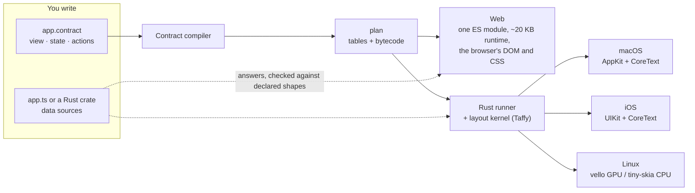

# Exact

**Write an app once. Exact runs it natively on the web, macOS, iOS and Linux, with
Android and Windows in early form, and a coding agent can build, run, see and test it on
each of them.**

Exact is a framework for apps that run on several platforms from one source. You describe
the interface in **Contract**, a small declarative language whose layout and property names
are CSS's. You write the data logic in **TypeScript or Rust**, or declare a plain HTTP read
in Contract itself and write no data code at all. On the web, the build is one ES module
over a runtime of about 20 KB that drives the browser's own DOM and CSS. On macOS and iOS,
the app is AppKit or UIKit views and the system's own controls. On Linux, Exact paints the
screen itself. No platform uses a webview or a JavaScript bridge in the UI, and no app
JavaScript runs before the first frame.

Exact is for developers who want one app on many platforms that looks and behaves native
on each, and for the coding agents they work with: every tool reports in a form a program
can read, and an agent can operate a running app on any platform. If you know React
Native or Flutter, [Compared with React Native and Flutter](#compared-with-react-native-and-flutter)
says what is different.

| Platform | Status | What draws the app |
|---|---|---|
| Web | Works | The browser's DOM and CSS |
| macOS | Works | AppKit views and native controls (no SwiftUI) |
| iOS | Works, on the Simulator and on devices | UIKit views, native controls and the system's bars |
| Linux | Works | Exact's painter, on the GPU or the CPU, on a DRM/KMS console or headless |
| Android | [Early](#early-android-and-windows): builds, runs and passes its tests on an emulator or a phone | Exact's painter, replayed onto Android's Canvas, with Android's own text fields |
| Windows | [Early](#early-android-and-windows): general control parity and delivery are unfinished | Exact's painter, in Fluent style, on DirectX 11 or the CPU |

The repository also has a tvOS variant of the iOS host, a watchOS app drawn by SwiftUI,
and a terminal host for apps written for the terminal.

> [!NOTE]
> Exact is pre-1.0 and changes daily. There is no API stability, no backwards
> compatibility and no migration guide, by design (`rules/DEFERRED.md`). There is no
> packaged release: you work from a checkout of this repository.

<table>
  <tr>
    <th>Web</th>
    <th>iOS</th>
    <th>macOS</th>
  </tr>
  <tr valign="top">
    <td></td>
    <td></td>
    <td></td>
  </tr>
  <tr valign="top">
    <td>The browser's own DOM and CSS</td>
    <td>UIKit views, native controls and the system's tab bar</td>
    <td>AppKit views and native controls</td>
  </tr>
</table>

<sub>One <code>app.contract</code>, the same screen on three hosts, captured by the agent driver. <a href="https://github.com/expo/exact-templates/tree/main/softwear">Softwear</a> is a demonstration store you can generate from <a href="https://github.com/expo/exact-templates">exact-templates</a>: it shows Alternative Apparel's catalog, is not affiliated with that brand, and takes no real orders or payments.</sub>

The smallest useful app is one file. This one has a piece of state, an action that changes
it, and a view:

```contract
component App
  state count = 0
  action increment
    count = count + 1
  view
    button press=increment
      text `Count: ${count}`
```

It names no colour, font or size, so each platform draws its own button. [Contract](#contract)
below shows a complete todo app with its data in TypeScript and a test that runs on every host.

## Contents

- [Compared with React Native and Flutter](#compared-with-react-native-and-flutter)
- [Quick start](#quick-start)
- [Three principles](#three-principles)
- [How it works](#how-it-works)
- [Contract](#contract)
- [Example apps](#example-apps)
- [What works today, and what doesn't yet](#what-works-today-and-what-doesnt-yet)
- [Building for iOS on Linux and WSL](#building-for-ios-on-linux-and-wsl)
- [For agents](#for-agents)
- [Working on Exact](#working-on-exact)

## Compared with React Native and Flutter

React Native and Flutter also build apps for several platforms from one source. Exact
differs from them in five ways.

- **You write the interface in Contract.** Contract declares views, state and the
  actions that change it; it performs no I/O and runs no arbitrary code. Data code, in
  TypeScript or Rust, sits behind one typed boundary.
  In React Native you write React components in JavaScript or TypeScript, and in Flutter
  you write widgets in Dart. The cost of Exact's choice is a new language to learn,
  though a small one.
- **Layout is CSS, and the browser is the reference.** A bare Exact node lays out like a
  bare `<div>`, and native layout is tested against what Chrome draws. React Native's
  layout engine, Yoga, implements flexbox with different defaults: a view is a column
  and does not shrink. Flutter has a layout model of its own.
- **Presentation you leave out comes from the platform.** On iOS and macOS, a button
  you do not style is UIKit's or AppKit's own button, and text takes the system's size
  and colour. React Native also shows native views on iOS and Android. Flutter draws its
  own widgets on every platform, with a Cupertino set that imitates iOS. On Linux,
  Android and Windows, Exact draws the interface itself too, apart from Android's own
  text fields.
- **On the web, the app is DOM and CSS.** The build is one ES module over a runtime of
  about 20 KB. React Native reaches the web through the separate React Native for Web
  library, and Flutter's web build draws into a canvas.
- **One driver operates every host.** The same ten operations (read the tree, tap, type,
  take a screenshot, advance the clock and five more) work on the web, macOS, iOS,
  Linux, Android and Windows. In a driven app, time moves only when the driver advances
  it, so a test advances the clock instead of sleeping. A test written as those
  operations runs unchanged on every host.

React Native and Flutter are mature: both have versioned releases, years of production
use, large communities, and package registries (npm and pub.dev). Exact has none of
these. There is no release and no package; you build from a checkout of this
repository, and its interfaces change daily. Its Android and Windows hosts are early.
Platform features come from the first-party packages in [`packages/`](packages); a data
module can import pure-JavaScript npm packages, but React Native and Flutter plugins do
not work. There is no JSX or React layer, so React components do not carry over.

## Quick start

These steps were run on macOS on Apple Silicon. Linux also runs the web loop, the Linux
host and the [iOS cross compiler](#building-for-ios-on-linux-and-wsl). Windows runs the
web loop and the Windows host; for iOS builds there, use WSL 2 with Ubuntu 24.04.

### 1. Install the tools

- **Rust** through [rustup](https://rustup.rs). The pinned stable toolchain in
  `rust-toolchain.toml` installs itself the first time Cargo runs.
- **[Bun](https://bun.sh) 1.4.2**, the version `package.json` pins. Node and npm are
  not needed. To install it beside an existing Bun:
  `curl -fsSL https://bun.sh/install | BUN_INSTALL=~/.bun-1.4.2 bash -s bun-v1.4.2`, then
  use `~/.bun-1.4.2/bin/bun` for the commands below if it is not on your `PATH`.
- **Apple's SDKs and Swift**, for Apple builds on macOS. The host needs Swift 6.4 or
  later (6.2.4 cannot type-check it) and the SDK of each platform it builds: macOS 26.0
  (Xcode 26.0), iOS 27.1 (Xcode 27.1) or tvOS 27.0 (Xcode 27.0).
  [`host/apple/devices.mjs`](host/apple/devices.mjs) holds these floors. Swift builds
  use the compiler `xcrun` selects; `DEVELOPER_DIR` or `TOOLCHAINS` chooses another.

Then `bun scripts/exact.mjs setup`, run once, installs the rest: the pinned stable Rust
and the pinned nightly that builds the web's wasm, with their components and targets (the
nightly's clippy lints a game's web build); the matching wasm-bindgen; the pinned Binaryen,
into `~/.cache/exact/binaryen`, where builds find it; the Bun dependencies; the Chromium
the pinned Playwright drives, which the agent uses for the web (`CHROME` selects another);
the crates of exact2's lock and the game SDK's (`game/app/shells.lock`), since builds resolve
crates offline; and the pinned, attested Hermes bundles TypeScript apps need on native
hosts: this machine's, the iOS and tvOS ones it can build, and Android's where the Android
SDK is installed. Ordinary builds never download or compile an engine;
[`docs/reference.md`](docs/reference.md) has the Hermes installer and its targets.
`setup --check` names what this machine is missing, the Apple SDKs and Swift among them,
without changing anything. For Hermes it runs the installer's offline check, which
authenticates the receipts, archives, compiler and host/target bytecode pairing.

### 2. Run Caltrain in the browser

```sh
git clone https://github.com/expo/exact.git
cd exact
bun scripts/exact.mjs setup
bun host/web/dev.mjs            # Caltrain, at http://127.0.0.1:8765/
```

The first run compiles the toolchain, which takes a few minutes. After that, open
[`apps/caltrain/app.contract`](apps/caltrain/app.contract), change some text, and save.
The page rebuilds and reloads in about a tenth of a second.

Add `--lan` to open the same page from a phone on your network. The server answers only to
the host names it prints, as a guard against DNS rebinding; a request with any other `Host`
gets 421. To share the page through a tunnel such as `tuft host`, name the tunnel's host
with `--allow-host <name>` (repeatable; `name:port` pins a port). An allowed name reaches
the page and its reload stream, never the local installer's token.

### 3. Run it natively

```sh
bun host/apple/build.mjs --run              # macOS
bun host/apple/build.mjs --ios --run        # an iOS Simulator (--device --run for a connected iPhone)
cargo build --profile host-dev -p caltrain-linux   # Linux: a DRM/KMS console, or headless anywhere (--release to ship)
```

A first native build takes ten to fifteen minutes on a laptop; later builds reuse it and
take a minute or two. Watch its output rather than waiting blind. iOS commands use an
iPhone simulator that is already booted, or boot the newest iPhone Pro. To choose one,
set `EXACT_SIM` to its name or UDID (or pass `--sim` to `build.mjs`), and keep the same
setting for `agent.mjs ios`.

On Linux KMS, `EXACT_ROTATE=0|90|180|270` turns the completed image clockwise.
Without it, the connector's `panel orientation` property chooses the angle; an
absent property means 0. At 90 or 270 degrees layout uses the swapped mode size.
The GPU rotates the image before display. Absolute evdev and VNC coordinates use
the inverse transform; relative mouse movement and scrolling keep the user's axes.
Agent screenshots show the rotated framebuffer, at the panel mode's size. Their
replies give that image's point dimensions and clockwise `rotation` in degrees;
comparison maps layout boxes onto those axes. Agent layout and target coordinates
remain logical. In a headless Linux host, `EXACT_SIZE` supplies the unrotated panel
size in points. Ink blits its retained target before readback; other painters
upload their completed pixels for the GPU blit. KMS still reads back into dumb
buffers.

On Linux, a development build can serve its screen over VNC: set `EXACT_VNC=1` and
`EXACT_VNC_PASSWORD` to 1–8 bytes. It listens on `127.0.0.1:5900`; `EXACT_VNC=host:port`
selects another address. Production bakes ignore both variables.

### 4. Make your own app

```sh
bun scripts/exact.mjs new ../hello          # or run `bun link` once, then `exact new ../hello`
cd ../hello
bun exact.mjs contract types app.contract -o app.contract.d.ts   # the first run builds the compiler
bun exact.mjs web                           # the dev loop, at http://127.0.0.1:8765/
bun exact.mjs test web                      # the app's *.test.contract, or the files named
bun exact.mjs mac --run                     # this Mac
bun exact.mjs ios --run                     # an iOS Simulator
```

`exact new` creates a standalone app: `app.contract` (the view), `app.ts` (its data),
`app.json` (the manifest: name, bundle id, hosts, deploy policy) and `app.test.contract`
(its test). The app holds no crate: a native verb (`mac`, `ios`, `linux`, `android`,
`windows`) builds in a Cargo workspace it generates under `.exact/shells/`, which uses your
exact2 checkout by path. `bun exact.mjs help` lists the commands, including
`bun exact.mjs contract …` for the compiler and `contract vocab` for a card of what an app
writes (`--all`: every tag and property Contract accepts).

Read [`docs/start-here.md`](docs/start-here.md) next, or for a website
[`docs/start-here-site.md`](docs/start-here-site.md). It is the only required reading for
building an app; the rest of the documentation is for lookup. The app's own `AGENTS.md`
(and `CLAUDE.md`) points a coding agent at the same guide.

To upgrade an app made with an older checkout, run these commands from its directory.
[Upgrading an inherited app](docs/start-here.md#upgrading-an-inherited-app) covers the
changes that need a hand edit.

```sh
bun exact.mjs update
bun exact.mjs contract migrate app.contract   # rewrites retired Contract syntax
bun exact.mjs lock
bun exact.mjs contract build app.contract --json --errors-only
```

Look at every screenshot, not only the test result: a test passes on a layout that spills
off the screen. `bun exact.mjs agent <host> "screenshot out.png"` shows the app on each
host in its own session; for a copy you launched yourself, use
`xcrun simctl io <device> screenshot out.png` on iOS.

`bun scripts/exact.mjs` also runs apps from this repository as real Mac apps:
`exact run markdown README.md`, or `exact install markdown` to put `mdview` on your
`PATH`. `exact list` shows what is here.

### Or ask a coding agent

On a Mac with Xcode, Rust and Bun installed, give Claude Code this prompt:

```text
Clone https://github.com/expo/exact and follow its README to make a new Exact
app with `exact new`. Run `bun scripts/exact.mjs setup` once first. Make a todo
list where I can add items, check them off, delete them,
and see how many are left. Put the view in Contract and keep the list in `app.ts`.
Write an `app.test.contract`, pass it on web, macOS, and the iOS Simulator with
`scripts/agent.mjs`, then open the app for me on all three.
```

On 2026-10-04, a fresh agent given an earlier version of this prompt on a clean clone,
with Hermes installed and Cargo's cache warm, finished in about 57 minutes, and its tests
passed on all three platforms. About 25 of those minutes were the first macOS and iOS
builds; later builds take a minute or two.

## Three principles

1. **Write the web, ship the platform.** What you write is CSS: its names, its layout
   model and the browser's fast development loop. What you leave out is the platform's:
   controls, colour, type, motion, gestures, the keyboard and accessibility come out as in
   an app built by hand for that platform. What you write wins (LLP 1115;
   [details](#what-is-csss-and-what-is-the-platforms)).
2. **An agent can do the whole loop.** It can create an app, run it on any host, see it,
   operate it, control its clock and run its tests, with no person watching
   ([details](#for-agents)).
3. **Fast to start and fast to change.** The budgets below come from `rules/RULES.md`.
   The gate's is checked on every change and the others every hour. A regression is top
   priority and is attributed to the commit that caused it
   ([details](#how-it-stays-fast)).

| Budget | Target |
|---|---|
| Cold start to interactive first frame | 100 ms p50 |
| Dev restart, edit to present | 100 ms p50 |
| App JavaScript executed before first pixel | none |
| Touch one line, rebuild that crate | 30 s |
| The blocking gate, warm, after a one-crate edit | 30 s |

## How it works



- **Contract** (`contract/`) is compiled in four passes (syntax, types, analysis, and
  lowering) into a *plan*: tables and bytecode for the views, state and actions. The web
  build compiles the plan into its ES module; on native hosts a Rust runner executes it.
  At build time the plan is *baked*: constant data is evaluated into it, so the first
  frame needs nothing else.
- **The runner** (`runner/`) is the plan's virtual machine. It handles keyed component
  instances, events, timers on a seekable clock, and the data seam: the one boundary
  where data enters the plan.
- **The kernel** (`kernel/`) is a columnar node arena with CSS layout through a patched
  [Taffy](vendor/taffy/EXACT-PATCHES.md). The host measures text: CoreText on Apple,
  cosmic-text on Linux. On the web, the browser lays out the same CSS itself, so the web
  build carries no layout engine.
- **Hosts** (`host/`) present the tree. The web host writes DOM nodes, and the browser
  runs CSS transitions. The Apple host is a static library with a C ABI under AppKit and
  UIKit presenters. The Linux host paints the tree itself, onto DRM/KMS with evdev
  input, or into an offscreen buffer.
- **Data sources** sit below the data seam. TypeScript runs on Hermes on native hosts and
  in the browser's own engine on the web. Rust runs natively, and can be replaced live
  (as a shared library, or as Wasm on iOS and the web). A source that is one HTTP request
  can be declared in Contract instead; an app whose sources are all declared links no
  JavaScript engine on native hosts. Every answer is checked against the shape Contract
  declared. Grants control network, files, SQLite, and secrets.
- **Optional pieces** are separate artifacts: a wgpu GPU module (Metal on Apple, WebGPU
  in the browser), native modules (a hyphenated tag backed by a platform widget, like
  MapKit), and a [game engine](game/README.md) add-on.

### What is CSS's, and what is the platform's

The order of precedence is the author, then the platform, then CSS's default. One test
settles a dispute: would someone who knows the platform notice the difference? If so, the
platform's answer wins.

- Layout is CSS's, because a person can't see a layout default, only its result. A bare
  node is `display: block`, `box-sizing: content-box`, `flex-direction: row`,
  `flex-shrink: 1`, the same as a bare `<div>`.
- Names are CSS's, because names are what you write: `font-size`, `object-fit`,
  `text-overflow`, `line-clamp`, `light-dark()`, `env(safe-area-inset-top)`. The compiler
  refuses an alias and names the web's spelling.
- Presentation you leave unsaid is the platform's. Text is the system's label colour and
  size (17 points on an iPhone, 13 on a Mac, the reader's setting in a browser), a
  `button` is the system's button, and a pushed screen has the system's Back. An app that
  says less looks more at home.
- The browser is the reference for layout and for what you wrote. Native layout given the
  same inputs, Canvas 2D, SVG, gradients, and authored motion are checked against what
  Chrome draws.
- The web is also the development loop. You work in the seconds-long web loop, and the
  native hosts are checked behind you.
- Any unavoidable deviation in layout is declared, with its reason, in LLP 1001. For
  example, Taffy has no `position: static`.

Writing the web doesn't mean the lowest common denominator. Where a platform can do more
(real HTML in an SVG `foreignObject` on the web, MapKit through a native module on Apple),
Exact lets it.

### How it stays fast

- **The boot path executes and compiles nothing.** TypeScript is compiled to Hermes
  bytecode at build time and loads after the first pixel. The first frame comes from
  data baked into the plan.
- **You pay only for what you use.** GPU rendering, the Markdown editor, text flow, and
  browser SQLite are separate artifacts, loaded on demand. Nothing is a feature flag on a
  core crate.
- **The web gets its own small runtime.** On the RealWorld ("Conduit") benchmark, Exact's
  runtime was up about 300 ms before the React SSR build had hydrated. It used 26 KB of
  code against React's 81 KB (LLP 1071).
- **Edits land in about a tenth of a second.** On a fresh app made by `exact new`, a saved
  Contract or TypeScript edit was rebuilt and in the page in 99 ms.

## Contract

Contract describes what an app shows and how its state changes. Its views and actions
don't fetch, read files, or run arbitrary code; data sources do that. Here is a complete todo app: a
Contract file, a TypeScript file, and a test. This exact app was built for web, macOS, and
the iOS Simulator, and its test passed on all three.

To try it in an app created with `exact new`, replace `app.contract`, `app.ts` and
`app.test.contract` with the examples below.

```contract
// app.contract: the view, its state, and what each action changes. It names no colour,
// font or control size: each host draws its own heading, field, button, checkbox and list.
shape Todo
  id: string
  title: string
  done: bool

shape Change
  count: number

component Todos
  state draft = ""
  mutation changed as shape Change refreshes todos
  resource todos = todos() as shape Todo[]
  derive left = todos.filter(t => not t.done).length

  action edit(value: string)
    draft = value
  action add
    if draft.trim() != ""
      send changed = addTodo(draft.trim())
      draft = ""
  action toggle(id: string, done: bool)
    send changed = setDone(id, done)
  action remove(id: string)
    send changed = removeTodo(id)

  view
    list appearance="auto" height="100%"
      section
        header
          text `${left} left` role="heading" testId="count"
        row
          input value=draft input=edit submit=add placeholder="What needs doing?" aria-label="New todo" testId="new-todo" flex=1 min-width=0
          button press=add buttonStyle="filled" testId="add"
            text "Add"
      section
        for t in todos key=t.id
          row delete=remove(t.id) testId=`todo-${t.id}`
            input type="checkbox" checked=t.done change=toggle(t.id) aria-label=t.title testId=`toggle-${t.id}`
            text t.title flex=1
            button press=remove(t.id) destructive=true testId=`remove-${t.id}`
              text "Delete"
```

```ts
// app.ts: keeps the list, and answers what app.contract asks for
import type { Answer, Sources } from './app.contract.d.ts';

export const grants = '';  // e.g. 'net.fetch https://api.example.com'

type Todo = { id: string; title: string; done: boolean };
let todos: Todo[] = [];
let next = 1;

const sources: Sources = {
  todos: () => todos,
  addTodo: ([title]) => {
    todos = [...todos, { id: String(next++), title, done: false }];
    return { count: todos.length };
  },
  setDone: ([id, done]) => {
    todos = todos.map((t) => (t.id === id ? { ...t, done } : t));
    return { count: todos.length };
  },
  removeTodo: ([id]) => {
    todos = todos.filter((t) => t.id !== id);
    return { count: todos.length };
  },
};

export const answer: Answer = (source, args, store, storage, native) =>
  sources[source](args, store, storage, native);
```

```contract-test
// app.test.contract: runs on any host with `scripts/agent.mjs <host> --test`
test "add, finish and delete"
  expect text "count" == "0 left"
  type "new-todo" "Buy milk"
  tap "add"
  type "new-todo" "Walk the dog"
  type "new-todo" key "Enter"
  expect text "count" == "2 left"
  tap "toggle-1"
  expect text "count" == "1 left"
  tap "remove-1"
  expect tree missing "todo-1"
  expect tree has "todo-2"
```

<table>
  <tr><th>Web</th><th>macOS</th><th>iOS Simulator</th></tr>
  <tr>
    <td></td>
    <td></td>
    <td></td>
  </tr>
</table>

The view never edits the list itself. An action `send`s a *mutation* to a source,
`app.ts` changes its data and answers, and `refreshes todos` asks for the list again.
Data lives in one place, and every change to it is a named, typed call an agent can see.
This list lives in memory. To keep it across launches, give `app.ts` a grant like
`sqlite.open app:/data/todos.db` and use `storage.sqlite`, as
[Fieldnotes](apps/fieldnotes) does.

A source that is one HTTP request needs no `app.ts`: declare it in `app.contract` with
its URL, and Contract reads the JSON reply into the shape. The URL's origin is its grant.
[The declared-source recipe](docs/recipes/declared-source.md) has whole examples, and
[Weather Now](apps/weather-now) is an app built that way.

For more, read the complete [guide for humans](docs/contract-for-humans.md), or look
things up in the [guide for agents](docs/contract-for-agents.md), the
[grammar and vocabulary reference](docs/contract-grammar.md) and the
[recipes](docs/recipes/).

### The pieces

| Concept | What it is |
|---|---|
| `shape` | A closed record type. Fields are `number`, `string`, `bool`, another shape, `option<T>`, or `T[]`. |
| `component` | A unit of UI. The first one in a file is the root. Components take `props`, can `inject` what an ancestor `provide`s, and can fill a `slot` with `children`. |
| `state` | A value the component owns, its type inferred or declared (`state picked: option<Item> = none`). Under a `for`, child state belongs to that keyed row. |
| `derive` | A value computed from others, recomputed when they change. |
| `resource` | Data from a source: `resource x = source(args) as shape T`. When the arguments change, the source is asked again. |
| `mutation` / `send` | A change made through a source: `send x = source(args)`. `refreshes r` asks resource `r` again afterward, `pending(x)` and `failed(x)` show progress, and `failure(x)` says why a resource failed. |
| `source` | A source declared in `app.contract`: one HTTP request (`url`, `method`, `header`, `body json` or `graphql`, `pointer`) whose JSON reply is read into a shape. |
| `action` | The only place state changes. What it writes is inferred from its body, and `let` binds a local inside it. |
| `task` | Work on a schedule: `every(1000, tick)`, `after(ms, a)`, `every(frame, a)`. |
| `view` | Indented elements, `if … else`, `for … key=…` (a key is required), `match` over options, and calls to other components. |
| `style` / `class=` | A named set of CSS properties. The node's own attributes win, and there is no cascade. |
| `fn`, `xs.map` / `xs.filter` / `xs.join` | Pure, single-expression helpers. Recursion is refused. |
| Built-in functions | The web's string and array methods by their names, called on the value (`xs.length`, `s.trim()`, `s.includes(t)`, `xs.at(-1)`), and functions (`first(xs)`, `formatDate`, `formatNumber`); all are listed with their types under `stdlib` in [`plan/tables/format.json`](plan/tables/format.json). |
| `routes` | A router: a location and a retained stack per tab, moved with `open`, `push`, `replace`, and `back`, and read with `top`. |
| `font` | Declares a font family and binds it to files at build time. |
| `use … from "./x.contract"` | Imports components, shapes, styles, and `fn`s from another Contract file. |
| `testId` | A stable name for the agent, tests, and accessibility tools. |

### What Contract leaves out, and why

- **No JavaScript in the view, and no I/O.** Expressions have no effects. Effects
  happen only in actions, as assignments, `send`, `refresh`, or commands like
  `focus(…)` and `share(…)`. Data crosses one seam: a source answers, and the runner
  checks the answer.
- **No loops in actions, no `await`.** A list is a view's keyed `for`, a computation is a
  `derive` or a `fn` (an action may name a value with `let`), and anything slower lives in
  a source. A list that changes changes where its data lives, through a mutation, as in
  the example above. That is what lets the plan be baked, diffed, inspected, and executed
  the same way on every host.
- **No escape hatch, but access hatches.** Nothing steps outside the plan. Where an app
  needs a platform widget, it uses a *native module*: a hyphenated tag like `exact-map`,
  backed by Swift, Kotlin or Rust, laid out by the kernel like any other box. Where it
  needs the platform object Exact itself built (a `UIView`, a navigation controller, a DOM
  element), it marks the node `hatch="word"` and its native code is handed that object.
  This is an *access hatch*, named after the panel a machine is built with so its insides
  can be reached. The native code configures what Exact made, and changes Contract state
  only by acting on authored nodes, as a person would.

These limits serve the principles. An agent cannot write a data race, because the language
cannot express one. A plan with no JavaScript in it starts fast. A view written in CSS's own words
lays out the same on every host and looks at home on each.

### The compiler talks back

```sh
$ cargo run -q -p contract -- build app.contract
app.contract:4:5 [type-assign] `count` is `number`, cannot assign `string`
app.contract:7:23 [lower-unknown-attr] `text` has no attribute `size`; `size` is spelled `font-size` here, the web's name (LLP 1017 §8.1)
```

One run reports up to twenty independent errors, not just the first. Other subcommands:
`--json` for tools, `symbols` (definitions and references as JSON), `fmt`
(source-preserving), `types` (generates `app.contract.d.ts` for TypeScript sources),
and `rust` (shapes for a Rust data crate). The full language is in
[the grammar reference](docs/contract-grammar.md); its design is LLP 1006, LLP 1017.000
(v1.1), LLP 1017.003, for data sources LLP 1027, and for declared sources LLP 1162.001.

## Example apps

Each app lives in [`apps/<name>/`](apps). Run one on the web with
`bun host/web/dev.mjs --app <name>`, on macOS with
`bun host/apple/build.mjs <name>-apple --run`, and on iOS by adding `--ios`. All of
these screenshots come from the web host, taken by `scripts/agent.mjs`.

To learn from, start with [Shelf](apps/shelf), the recipe app. It names no colour and no
font size, and `scripts/no-tells.mjs` holds it to that, so it shows what an app that
leaves presentation to the platform looks like on each host. Then read these for what
each teaches. Except Weather Now, they paint their own colours and sizes, which LLP 1115
now leaves to the platform, so take their structure, not their style:

| App | What it teaches |
|---|---|
| [Caltrain](apps/caltrain) | A Rust data crate, authored tests, routes, an optional GPU module |
| [Weatherlight](apps/weatherlight) | TypeScript with `fetch` and grants |
| [Weather Now](apps/weather-now) | Sources declared in Contract, with no `app.ts` and no JavaScript engine |
| [Fieldnotes](apps/fieldnotes) | Storage: SQLite, files, backup and restore |
| [Recorder](apps/recorder) | The microphone through `@exact/media-capture` and `@exact/recording` |

<table>
  <tr>
    <td width="25%"></td>
    <td width="25%"></td>
    <td width="25%"></td>
    <td width="25%"></td>
  </tr>
  <tr valign="top">
    <td><a href="apps/caltrain"><b>Caltrain</b></a><br>The app that defines v1: nearby stations, live departure boards, search, theming, a Canvas 2D line map, and an aurora GPU sky. Rust data. Every host.</td>
    <td><a href="apps/weatherlight"><b>Weatherlight</b></a><br>Weather from Open-Meteo under a GPU-animated sky that follows the hour you pick. TypeScript data and a wgpu module.</td>
    <td><a href="apps/spark"><b>Spark</b></a><br>A swipe deck: throw a card with your finger, and it flies off with your release velocity. Pan gestures and springs on every host.</td>
    <td><a href="apps/expose"><b>Expose</b></a><br>A pretend phone OS (lock screen, home, Messages with an AI assistant, Reader) set in custom fonts. TypeScript. The assistant needs an OpenRouter key.</td>
  </tr>
  <tr>
    <td></td>
    <td></td>
    <td></td>
    <td></td>
  </tr>
  <tr valign="top">
    <td><a href="examples/calendar"><b>Calendar</b></a><br>Month pages, draggable sheets, events dragged between days, wallpaper themes, SQLite. It lives outside <code>apps/</code>, so set <code>EXACT_APP_DIR</code> to run it.</td>
    <td><a href="apps/sparkline"><b>Sparkline</b></a><br>A market list of animated SVG charts that draw in and pulse.</td>
    <td><a href="apps/photo-editor"><b>Photo Editor</b></a><br>Rotate, pan, and crop, through a native module.</td>
    <td><a href="apps/video-player"><b>Video Player</b></a><br>A bundled clip that shrinks out of the way when the keyboard opens.</td>
  </tr>
</table>

<table>
  <tr>
    <td width="50%"></td>
    <td width="50%"></td>
  </tr>
  <tr valign="top">
    <td><a href="apps/exact-live"><b>Exact Live</b></a><br>A creative-production workspace: a photo grid you reorder by dragging, a crew chat that can take a 10,000-message burst, and a Markdown runbook. Rust data.</td>
    <td><a href="apps/interaction-gallery"><b>Still</b> (Interaction Gallery)</a><br>Drag to reorder, pan and zoom photos, a resizable sheet with a nested list, and 100 to 25,000 records.</td>
  </tr>
  <tr>
    <td></td>
    <td></td>
  </tr>
  <tr valign="top">
    <td><a href="apps/reflow"><b>Reflow</b></a><br>Seven typography studies after Cheng Lou's Pretext demos: text flowing around moving balls, a dragon, masonry, and a magazine spread. Line heights come from font metrics read at build time.</td>
    <td><a href="apps/textflow"><b>Textflow</b></a><br>Text around shapes with CSS's <code>shape-outside</code> and <code>wrap-flow</code>: draggable orbs, a dancer, an editorial layout. One Rust walker shared by every host.</td>
  </tr>
  <tr>
    <td></td>
    <td></td>
  </tr>
  <tr valign="top">
    <td><a href="apps/markdown"><b>Markdown</b></a><br>A Markdown reader that opens files from Finder or the command line (<code>mdview README.md</code>). Its sibling <a href="apps/llp"><b>LLP</b></a> (<code>llpview</code>) reads a directory of numbered design documents (LLPs).</td>
    <td><a href="apps/realworld"><b>Conduit</b> (RealWorld)</a><br>The RealWorld Medium clone against its hosted API. It's the benchmark that compared Exact's web build with React 19. Web only.</td>
  </tr>
</table>

<table>
  <tr><td></td></tr>
  <tr><td><a href="apps/svg-gallery"><b>SVG Gallery</b></a>: SVG as the browser renders it, one page per feature, held to Chrome's pixels on every host.</td></tr>
  <tr><td></td></tr>
  <tr><td><a href="apps/canvas-gallery"><b>Canvas Gallery</b></a>: the HTML Canvas 2D API drawn by the browser, Core Graphics, or tiny-skia, and compared to Chrome.</td></tr>
</table>

### More apps, labs, and stress tests

| App | What it shows | Notes |
|---|---|---|
| [Fieldnotes](apps/fieldnotes) | A local notebook with pins, search, SQLite storage, and JSON backup and restore | TypeScript + Rust |
| [Messages](apps/messages) | A port of Expo's chat demo, talking to models through OpenRouter | Needs `bun apps/messages/service.ts` and an OpenRouter key |
| [Type Tour](apps/typetour) | Phone-OS screens as a type specimen for the Expose fonts | No JavaScript at all |
| [Map Demo](apps/map-demo) | Native modules: MapKit on Apple and OpenStreetMap on the web | |
| [Carousel](apps/carousel) | A horizontal virtualized list of 25,000 cards | |
| [Motion Gallery](apps/motion-gallery) | Animated GIF and WebP images and CSS keyframes, compared across hosts | |
| [Update Lab](apps/update-lab) | Live replacement of Contract, TypeScript, and Rust in a running app | Hand-testing lab |
| [Messages Stress](apps/messages-stress), [Completion Storm](apps/completion-storm), [Markdown Stress](apps/markdown-stress) | 100k-message histories, 128 parallel requests, and 4 MiB documents, under load | Opt-in workloads (LLP 1041) |
| [Native Fixture](apps/native-fixture), [Auth Fixture](apps/auth-fixture) | The native-module interface; OAuth with PAR, DPoP, and PKCE against a local server | Test fixtures |
| [Beacons, Tennis, …](game/games) | Games on the optional [engine add-on](game/README.md): Rust gameplay, Contract menus | `bun game/dev.mjs beacons` |

## What works today, and what doesn't yet

The v1 bar, from `rules/DEFERRED.md`: *one real application, not a demo, runs from a
single Contract source on web, macOS, iOS, and Linux, within the time budgets in
`rules/RULES.md`.* Caltrain is that application, and it runs on all four. Everything
else here was admitted because a real app needed it.

### Working

- **Four hosts**, as in the table at the top. Existing Swift apps can embed Exact
  sessions through ExactKit (LLP 1031).
- **Layout and text.** CSS block, flex, and grid; `position: static` and containing
  blocks; `aspect-ratio`; declared fonts; text around shapes (LLP 1043.000).
- **Paint.** Gradients, shadows, `backdrop-filter`, glass materials, complete SVG
  (LLP 1055), Canvas 2D on every host (LLP 1056), and a wgpu GPU canvas loaded after
  first pixel.
- **Motion.** CSS transitions, springs, `@keyframes`, follow-and-release gestures (pan,
  swipe, pinch) with release velocity, layout transitions, exit animations, and
  drag-linked timelines (LLP 1002, LLP 1063, LLP 1057.003); a scroller is not yet a
  timeline's source.
- **Lists.** Virtualized lists, vertical or horizontal, one level deep (LLP 1070). The
  rows of a vertical `list` are its platform's: UIKit's separators and highlight, a table
  on the Mac, one line between rows on the web, with nothing drawn by the app
  (LLP 1115.000, D16).
- **Controls and media.** Inputs, `select`, a WYSIWYG Markdown editor on the web, macOS,
  and iOS (LLP 1045), images including animated ones, video (LLP 1042), pickers for an
  app's declared file types, and share.
- **Camera.** [`@exact/camera`](packages/camera/exact.json) shows a live viewfinder
  (`exact-camera srcObject=`) and takes still photos (`takePhoto`) on the web, iOS,
  macOS, and Android, behind the `device.camera` grant (LLP 1133.008).
  `takePhotoWithCameraApp` takes one in the system camera UI instead: Android's camera
  app, iOS's camera picker, and on the web a file input with `capture`;
  `recordVideoWithCameraApp` records a video there (LLP 1133.008.000). Neither needs a
  grant on Android; iOS shows the `device.camera` line's purpose, and for a video the
  `device.microphone` line's too. `startMediaRecorder` in
  [`@exact/recording`](packages/recording/README.md) records the viewfinder's stream
  in the app on Android, the web, iOS and macOS. The camera does not hand its frames
  to code and has no Windows, Linux, tvOS, or watchOS implementation.
- **Data.** TypeScript or Rust sources, optionally on a worker, and sources declared in
  Contract: an HTTP request whose JSON answer is read field by field. An app whose sources
  are all declared has no data module, and its native build links no JavaScript engine
  (LLP 1162.001). Grant-checked `fetch` and streams, files and SQLite (native and
  in the browser), Keychain secrets, and OAuth sign-in. A router keeps a stack per tab
  (LLP 1038).
- **Native modules.** Platform widgets as hyphenated tags (LLP 1024).
- **The web, server side.** Pages pre-rendered at build time or per request by a Rust
  renderer, then adopted in place instead of hydrated (LLP 1048).
- **Delivery.** `scripts/deploy.mjs` publishes the web root and signed update bundles,
  which installed apps fetch after first pixel. Existing streams use their signed
  cohort receipts: Linux can publish compatible Contract and TypeScript updates
  to iOS without an Apple bake. Candidates the cohort cannot run are reported as
  needing a binary. Apple apps check every fifteen minutes while active under every
  activation policy; `deploy.check.interval` overrides the interval in seconds. Checks
  stage a candidate; `deploy.activate` controls when it applies. TypeScript and Rust
  logic can be replaced live in development. Every web build gets an install page, and
  `exact release` signs and notarizes a Mac app (LLP 1030).
- **Agents and tests.** The same driving operations on every host, including a physical
  iPhone; Contract tests; source maps; filmed screenshots.

### Early: Android and Windows

- **Android** is early. An app builds for Android and runs on an emulator or a phone:
  `bun exact.mjs android` builds it, `bun exact.mjs test android` runs its tests, and
  `bun exact.mjs agent android …` drives it (LLP 1107). It needs the Android SDK, the
  Rust target `aarch64-linux-android`, and the Hermes Android bundle, which `exact setup`
  installs with the target. `bun exact.mjs android --bundle` produces a signed release
  App Bundle; the [phone release recipe](docs/recipes/mobile-build.md) names the
  upload-key and version inputs. Play upload and store submission remain the publisher's
  work.
- **Windows** is early. Apps default to the `ink` painter on a DirectX 11 composition
  swap chain, or the CPU painter when the manifest declares `game`. `host.windows.painter: "ink"` or `"cpu"` selects
  either painter, and `EXACT_PAINTER` overrides both. Skirmish is a standalone game built
  with Exact's optional game engine; the CPU default preserves its module-owned window
  presentation (LLP 1149 D12). [Windows Desk](apps/windows-desk/README.md) demonstrates
  native controls over Contract and the kernel with an app-local Win32 presenter; general
  Windows control parity and delivery remain unfinished. A `-exact-menu="status"` button
  becomes a notification-area icon with a painted menu (LLP 1133.025 D4). On Windows 11 a
  hidden launch, pointer input, checkbox state, Exit and placement clear of a taskbar that
  hides automatically work; its UI Automation menu tree and file-backed status images at
  changing display scales have not yet been run on Windows.

### Not yet, or not at all

- **No JSX or React tier.** Nothing runs JavaScript above the data seam. The door stays
  open, but no one is building it.
- **Code updates in production.** Signed delivery covers plans, assets and one
  module pair: Apple accepts TypeScript or an enabled Rust module, Linux a Rust
  module only, and Windows has no update store. The installed binary's runtime,
  app identity, grants and Rust policy still bind. Delivering TypeScript and Rust
  modules together is not implemented.
- **The Markdown editor off the web and Apple.** On Linux, Windows and Android it shows
  the source. Linux also has no word segmenter, so flowed Thai, Lao, Khmer, and Myanmar
  text breaks only at spaces.
- **Out on purpose for v1.** A gesture arena, general layout animation, grid or
  masonry virtualization, a general webview beyond `iframe`, and a devtools UI.
- **No packaged CLI.** You work from a source checkout. `exact new` apps refer to it by
  path.

[`QUEUE.md`](QUEUE.md) lists what would make sense to do next.

## Building for iOS on Linux and WSL

Install [Swift 6.4.2](https://www.swift.org/install/linux/),
[xtool 1.24.0](https://github.com/xtool-org/xtool/releases/tag/1.24.0),
[LLVM 23](https://apt.llvm.org/), and
[apple-codesign 0.29.0](https://github.com/indygreg/apple-platform-rs/releases/tag/apple-codesign%2F0.29.0).
Download Xcode 27.1 from [Apple](https://developer.apple.com/download/all/?q=Xcode%2027.1),
then run `APPIMAGE_EXTRACT_AND_RUN=1 xtool sdk install --slim /path/to/Xcode_27.1.xip`.
This extracts the SDK; it does not run Xcode. The environment variable lets xtool's
AppImage run without FUSE.

- In WSL 2, keep the checkout and SDK in Ubuntu's Linux filesystem.
- Put LLVM's `bin` directory on `PATH` and set `EXACT_APPLE_LLVM_BIN` to that directory
  (on Ubuntu, `/usr/lib/llvm-23/bin`). Swift and `rcodesign` must also be on `PATH`; IPA
  archives also need `zip`.
- For a signed device archive, set `EXACT_IDENTITY` to an absolute PKCS#12 file path,
  `EXACT_APPLE_SIGN_PASSWORD_FILE` to its password file, and `EXACT_PROFILE` to the app's
  provisioning profile. Set `EXACT_PROFILE_DIR` to a directory containing companion
  extension profiles. Profile decoding needs `openssl`. On macOS, `EXACT_IDENTITY`
  continues to name a Keychain identity.
- `EXACT_APPLE_SDK` can select a Darwin SDK bundle outside xtool's default
  `~/.swiftpm/swift-sdks/darwin.artifactbundle`.
- Watch simulator companions require `xtool sdk install /path/to/Xcode_27.1.xip` without
  `--slim`, so Exact can install the retained watch SDK on the first watch build.
- Icon Composer projects retain their live SVG layers on iOS 26 and newer; Linux uses the
  manifest's PNG `icons` entry as artwork for older iOS versions. The portable compiler
  supports the checked-in projects' default SVG group and opaque sRGB background; other
  Composer settings are refused explicitly.
- For the SVG filter kernels and Canvas 2D GPU module on x86-64 Linux/WSL, install Wine 9
  or newer and download [Metal Developer Tools for Windows](https://developer.apple.com/metal/tools/).
  Extract the installer with `7z x -o/path/to/metal-tools Metal_Developer_Tools6.2Windows.exe`,
  then set `EXACT_APPLE_METAL_TOOLS=/path/to/metal-tools` (the directory containing
  `bin/metal.exe`). The qualified compiler is Metal 32023.850 from the 6.2 Windows
  installer. `EXACT_APPLE_WINE` can select Wine's executable; otherwise Exact uses
  Ubuntu's `/usr/lib/wine/wine64` when present, then `wine` on `PATH`. Wine runs only at
  build time. Its prefix defaults to `~/.cache/exact/windows-metal`; `WINEPREFIX`
  overrides it.

With the cross SDK installed, `setup` also installs the iOS Rust targets. Build a
simulator bundle with `bun host/apple/build.mjs --ios --no-install hello-apple`. In an app
made with `exact new`, `bun exact.mjs ios` builds without installing on Linux/WSL;
`ios --prebuild` runs the same build in the background. Linux defaults to an ARM64
simulator target; `EXACT_IOS_SIM_ARCH=x86_64` selects an Intel simulator. Execution needs
an iOS simulator on macOS or an iPhone; compilation, asset catalog generation, App Intents
metadata and ad-hoc signing run on Linux.

Production builds with custom native views also validate the compiled factory roster.
Linux can import a simulator qualification with
`EXACT_NATIVE_ROSTERS=/path/to/qualification.json`. It contains
`{ "version": 1, "probes": [{ "probeSha256": "…", "roster": "<JSON object>" }] }`. The
build writes `native-probes.json` beside its link products to name the probe directory it
keeps. Copy that whole directory to a Mac and run its probe with
`xcrun simctl spawn <simulator> <directory>/ExactRosterProbe`. The printed JSON is the
qualification's `roster` string, and the `probeSha256` the file lists is its digest. The
digest covers every file in the directory: the executable, the module library, package
libraries and declared frameworks, so changing any of them requires a new simulator run.
Without a matching qualification, a production build refuses rather than accepting an
absent factory or omitting its first-frame declaration. Development builds keep the
manifest fallback.

## For agents

Exact assumes much of an app's code will be written by AI agents, and its tools are built
so an agent can make an app, run it, look at it, operate it, and show that it works with
no person in the loop.

- **The same operations on every host.** `tree · screenshot · tap · type · state ·
  layout · logs · clock · prefer · perf` drive the web, macOS, iOS (Simulator or a real
  iPhone), Linux, Android and Windows through one script, `scripts/agent.mjs`.
  `bun scripts/agent.mjs --help` lists every operation and flag.
- **The agent controls the clock.** In a driven app, time moves only when the agent
  advances it, so nothing changes between two operations. Instead of sleeping until an
  animation finishes, the agent advances the clock (`clock +60000`) or lets everything
  pending finish (`clock settle`), then reads the result. Tests do not depend on how long
  a step happened to take.
- **Tests are scripts of those operations.** An `app.test.contract` file runs unchanged
  on any host, with no second evaluator.
- **Every tool reports in a form a program can read.** `contract build --json` gives
  diagnostics with stable ids and source ranges. `contract symbols` gives navigation. A
  development source map leads from any node on screen back to the line that declared it.
  The driver refuses to drive a build older than its sources and names the rebuild.
- **Contract is small on purpose.** A whole app fits in a model's context window. Every
  write is declared, every list is keyed, every value is typed. A mistake is a refusal
  that says what to do, not quiet misbehavior.

### Drive an app

```sh
bun host/web/build.mjs caltrain-web         # the build the agent's web host serves
bun scripts/agent.mjs web tree "tap change-station" "type station-search Palo" \
  "clock +60000" state "screenshot out.png"
bun scripts/agent.mjs web --test apps/caltrain/app.test.contract
```

Swap `web` for `macos`, `ios`, or `linux` once that host is built. Caltrain's three
tests take about two seconds on the web host. Each operation is one shell argument, so
quote it: `"type new-todo Buy milk"` types `Buy milk` (everything after the target is
the text). `"screenshot film.png over 600 every 50"` films motion as a contact sheet; use
an `.apng` name to get an animation.

To drive an app made with `exact new` from this checkout, point `EXACT_APP_DIR` at it:

```sh
EXACT_APP_DIR=../hello bun host/web/build.mjs hello-web
EXACT_APP_DIR=../hello bun scripts/agent.mjs web --app hello tree "screenshot hello.png"
```

### Feedback

An app's `AGENTS.md` asks its agent to record friction in one line, `bun exact.mjs
feedback note "<what happened>"`. A note stays in the app's `.exact/` with exact2's commit
and the last command's verb, exit code and duration; never any command output, or the
app's code or files. It goes to Expo only when the project allows it, by default after
`bun exact.mjs feedback` shows exactly what would go. `bun exact.mjs feedback never` stops
it for a project, and `EXACT_FEEDBACK=0` on the machine. [docs/diary.md](docs/diary.md)
has the details, including the endpoint and when a command prompts for a note.

## Working on Exact

Start with [`rules/RULES.md`](rules/RULES.md), one page on how work happens here, and
[`rules/DEFERRED.md`](rules/DEFERRED.md), what v1 deliberately leaves out. Agents should
also read [`AGENTS.md`](AGENTS.md). In short:

- **One blocking gate, 30 seconds warm: `bun scripts/gate.mjs`.** Stage your files,
  run it, push, and fix what the hourly lane attributes to you. The gate runs format,
  file-size caps, the boot-graph count, an incremental Cargo check and small unit
  suites; it reports every failure and each part's time. Everything else (the full
  build and tests, affected suites, the Contract difftests, app drives, XCTests and
  platform builds) runs hourly through `bun scripts/async.mjs`, which bisects each new
  failure through that hour's commits.
- **Verify by running, not by reading.** The hourly lane builds and drives the apps a
  change affects. To investigate yourself, `bun scripts/smoke.mjs <web|macos|ios|linux>`
  drives the whole app on that host.
- **Delete; don't deprecate.** Before 1.0 there are no compatibility shims. Generated
  files are built, never committed.
- **Agents remove apparatus freely and add none** (checks, scripts, registries, design
  documents) without a person saying so.
- **Design happens in LLPs.** These are the numbered documents of the design record. A
  spec gets written only when it has an implementer and a date.

The design record is a separate, private repository of LLPs, `expo/exact-llp`, which those
with access clone into `llp/` (git ignores it). This README and the guides cite it by
number (`LLP 1115 D7`); a reader without it learns only that the decision is recorded. The
guides under [`docs/`](docs) are the public documentation. This repository, `exact2`, is a
rebuild of an earlier one ("exact1"), whose design documents are research, never
authority.

Detailed operational notes cover toolchains, the Contract CLI's JSON formats, source
maps, TypeScript and Rust data modules, storage, live replacement, delivery trust, the
install page, and the stress harnesses. They're in
[`docs/reference.md`](docs/reference.md). Open issues are on GitHub and as files under
[`issues/`](issues) ([how that works](docs/issues.md)). [`CONTRIBUTING.md`](CONTRIBUTING.md)
says how to report what you hit.

### Repository map

| Path | What's there |
|---|---|
| [`kernel/`](kernel) | `exact-kernel`: the node arena, wire frames, transactions, Taffy layout, and the export. [`kernel/tables/schema.json`](kernel/tables/schema.json) declares every node type, property, and opcode. |
| [`contract/`](contract) | The Contract compiler (`syntax` → `types` → `analyze` → `lower`), its CLI, and the corpus |
| [`plan/`](plan), [`runner/`](runner) | The plan format, generated from one JSON authority, and the VM that runs it |
| [`motion/`](motion) | CSS transitions, springs, and the seekable clock for non-web hosts |
| [`host/`](host) | `web/`, `web-js/` (the JS target), `apple/` (Rust core, ExactKit Swift package, AppKit and UIKit), `linux/`, `painted/` (the painter Linux, Windows and Android share), `windows/`, `android/`, `terminal/`, `render/` (server pages), plus update adapters and rasterizers |
| [`js/`](js), [`logic/`](logic), [`data/`](data) | The TypeScript executor (Hermes, and the browser's engine on the web), Rust logic modules, and the data seam |
| [`gpu/`](gpu), [`canvas/`](canvas), [`textflow/`](textflow), [`markdown/`](markdown) | Capabilities loaded on demand: the wgpu canvas, Canvas 2D, text around shapes, and the Markdown editor |
| [`route/`](route), [`update/`](update), [`bake/`](bake), [`filesystem/`](filesystem) | The router, the signed update store, delivery baking, and app-owned files |
| [`apps/`](apps), [`examples/`](examples), [`game/`](game) | The apps above, the Calendar example, and the optional game engine |
| [`scripts/`](scripts) | `exact.mjs`, `agent.mjs`, `smoke.mjs`, `metrics.mjs`, `deploy.mjs`, and the checks |
| [`rules/`](rules) | [`RULES.md`](rules/RULES.md) and [`DEFERRED.md`](rules/DEFERRED.md), the two binding documents |
| [`vendor/taffy/`](vendor/taffy) | Taffy, plus Exact's patches |

### License and Snapback

The workspace is MIT-licensed ([`LICENSE`](LICENSE)).

The Snapback client (`snapback4/`) is not in this repository, and Exact works without it:
in a checkout without it, `exact new --snapback` and `bun exact.mjs snapback` refuse,
naming the missing client. A checkout that has it there uses published **0.4.33** with
the matching immutable Rust source revision `3653cae823145170df3e720f5e321bd1b5b4d79d`.
Its guide, `snapback4/README.md`, comes with that client, so a clean Exact checkout does
not have it; it covers wiring and device rebuilds.
