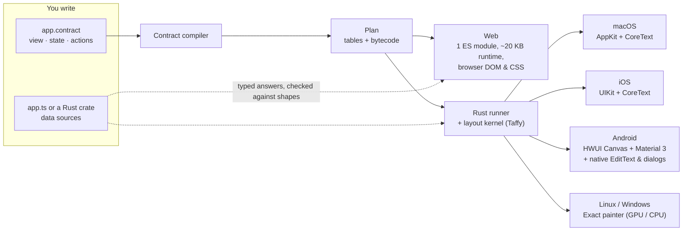

# Exact

**The all-platform app framework. Agent native. Built for speed. No compromises.**

Exact is an **all-platform** framework for building real apps on the web, iOS, macOS, Android, and Linux — with Windows in active development, plus tvOS, watchOS, Android TV, and the terminal.

Exact is not a "cross-platform" framework. Cross-platform tools usually trade away each platform's strengths to maintain a lowest common denominator. Exact takes the opposite approach: build something **excellent on every platform on its own terms** — real DOM on the web, real UIKit on iOS, real AppKit on macOS, hardware-accelerated Material 3 rendering with native Android views on Android, and direct GPU/CPU rendering on Linux and Windows. Being **all-platform** is simply the side effect of getting every platform right from one source.

Everything in Exact is built around three priorities:

1. **[Agent Native](#1-agent-native)** — Built from the ground up so coding agents can build, run, see, operate, and verify real apps on every platform through one deterministic loop.
2. **[Speed is King](#2-speed-is-king)** — 100 ms cold starts, 100 ms edit-to-present reloads, zero app JavaScript before first pixel, and a ~20 KB web runtime, held to hard budgets.
3. **[No Compromises — Build Exactly What You Want](#3-no-compromises--build-exactly-what-you-want)** — Native platform controls with zero tells when you leave presentation unsaid; full creative control over layout, motion, graphics, shaders, and native platform objects whenever you want it.

> [!NOTE]
> Exact is pre-1.0 and changes daily. There is no packaged release, API stability guarantee, or backwards-compatibility layer yet — you build from a checkout of this repository.

<table>
  <tr>
    <th>Web</th>
    <th>iOS</th>
    <th>macOS</th>
  </tr>
  <tr valign="top">
    <td></td>
    <td></td>
    <td></td>
  </tr>
  <tr valign="top">
    <td>The browser's own DOM and CSS</td>
    <td>UIKit views, native controls, and the system tab bar</td>
    <td>AppKit views and native controls</td>
  </tr>
</table>

<sub>One source, three platforms, captured by Exact's agent driver. <a href="https://github.com/expo/exact-templates/tree/main/softwear">Softwear</a> is a demo store from <a href="https://github.com/expo/exact-templates">exact-templates</a> (it displays Alternative Apparel's catalog, is not affiliated with that brand, and takes no orders or payments).</sub>

### Platforms

| Platform | Status | How it renders |
|---|---|---|
| **Web** | Works | Browser DOM (~20 KB runtime, zero layout engine shipped) |
| **iOS** | Works (Simulator & device) | UIKit views, native controls, and system bars |
| **macOS** | Works | AppKit views and native controls (no SwiftUI) |
| **Linux** | Works | Exact's painter draws in a Wayland window, full-screen on a DRM/KMS console, or into a headless buffer. |
| **Android** | [Works](#android) (Material 3 polish in progress) | Hardware-accelerated Android Canvas (`RenderNode`) with Material 3 styling, native `EditText`, dialogs, and Compose date pickers |
| **Windows** | [Early](#early-windows) | DirectX 11 (`ink`) or CPU painter (neutral look + Fluent symbols) with native file dialogs, IME, and UI Automation |

The repository also ships **tvOS** and **watchOS** hosts, **Android TV** support in the Android APK, and a **terminal** host (`exact-terminal`) for command-line apps.

### Contents

- [Why Exact?](#why-exact)
  - [1. Agent Native](#1-agent-native)
  - [2. Speed is King](#2-speed-is-king)
  - [3. No Compromises — Build Exactly What You Want](#3-no-compromises--build-exactly-what-you-want)
  - [All-platform vs. cross-platform](#all-platform-vs-cross-platform)
- [Quick start](#quick-start)
- [The agent loop](#the-agent-loop)
- [How an Exact app is written](#how-an-exact-app-is-written)
- [How it works](#how-it-works)
- [Example apps](#example-apps)
- [What works today, and what doesn't yet](#what-works-today-and-what-doesnt-yet)
- [Building for iOS on Linux and WSL](#building-for-ios-on-linux-and-wsl)
- [Working on Exact](#working-on-exact)

---

## Why Exact?

### 1. Agent Native

Most frameworks bolt AI support on afterward with docs and wrapper scripts. Exact is designed around the agent loop so coding agents — and the humans directing them — can go from edit to verified native app on every platform without babysitting.

- **One driver operates every platform.** The same 10 operations (`tree`, `screenshot`, `tap`, `type`, `state`, `layout`, `logs`, `clock`, `prefer`, `perf`) drive the web, macOS, iOS Simulator, physical iPhones, Linux, Android, and Windows through `scripts/agent.mjs`.
- **Deterministic, seekable time.** In driven mode, time only advances when the driver moves the clock (`clock +60000`, `clock settle`). Agents and tests never `sleep()` waiting for animations or network timers, and never flake on timing.
- **One-command verification.** `bun exact.mjs verify` (and `verify ios`) builds the app, runs all authored tests, checks light and dark mode, multiple screen widths, accessibility trees, dynamic-type overflow, and scroll feel in a single structured report.
- **Built to fit in context and fail clearly.** UI is declared in **Contract**, a compact, strictly typed language with no hidden side effects, no data races, and one explicit boundary to app logic. An entire app fits in a model's context window; development builds map every rendered node back to its declaring line; and the compiler reports up to 20 structured, actionable diagnostics per run.

### 2. Speed is King

Startup speed and feedback speed are hard architectural constraints, not tuning passes added later. Every budget in [`rules/RULES.md`](rules/RULES.md) is checked continuously — the gate on every change, the rest hourly — and regressions are bisected automatically to the breaking commit.

| Budget | Target |
|---|---|
| Cold start to interactive first frame | 100 ms p50 |
| Dev reload, save to present | 100 ms p50 |
| App JavaScript executed before first pixel | None |
| Touch one line, rebuild that crate | 30 s |
| Blocking gate, warm, after a one-crate edit | 30 s |

How Exact hits those numbers:
- **Zero compilation or app JS on the boot path.** Constant data is baked into the compiled plan at build time so the first frame paints immediately. TypeScript compiles to Hermes bytecode ahead of time and loads only after the first pixel.
- **No webviews, no UI bridge.** Native hosts execute the compiled plan directly in Rust; the web host compiles the plan to a single ES module over a ~20 KB DOM runtime.
- **Pay only for what you use.** Heavy capabilities — `wgpu` GPU canvases, the Markdown editor, text-around-shapes, browser SQLite, and the optional game engine — ship as separate on-demand artifacts rather than bloating every app.
- **Measured against real apps.** On the RealWorld ("Conduit") benchmark, Exact's web build ships 26 KB of code against React 19's 81 KB and becomes interactive ~300 ms before React SSR finishes hydrating.

### 3. No Compromises — Build Exactly What You Want

Exact refuses the classic false choice between "looks native, can't customize" and "fully custom, feels foreign." It makes every platform first-class so you never have to settle:

- **Native excellence with zero tells.** Precedence is **author → platform → default**. One test settles any dispute: *would someone who knows the platform notice?* Leave colors, type sizes, and control chrome unsaid and each host uses its real controls, bars, typography, gestures, haptics, keyboard behavior, and accessibility — UIKit on iOS, AppKit on macOS, the browser's own DOM on the web. Saying less makes an app feel completely at home.
- **Full creative control when you want it.** When you *do* want a bespoke design, Exact gives you the full power of web-standard layout and styling (verified against Chrome), complete SVG, Canvas 2D on every host, spring physics and velocity-preserving gestures, text flowing around arbitrary shapes, custom fonts, and `wgpu` GPU shaders (Metal on Apple, WebGPU on the web).
- **Direct access to every platform's native APIs.** Over 60 first-party packages in [`packages/`](packages) expose camera, passkeys, HealthKit, notifications, geolocation, maps, payments, speech, and more. Need a custom platform widget like MapKit? Drop in a *native module* (`exact-map`) backed by Swift, Kotlin, or Rust. Need to configure the exact `UIView`, navigation controller, or DOM node Exact created? Attach an *access hatch* (`hatch="name"`) and receive the real platform object directly.
- **Choose your data stack.** Write app logic in **TypeScript** (running on Hermes natively and the browser engine on the web) or **Rust** (native or Wasm, with live replacement), or declare plain HTTP/GraphQL reads directly in Contract so native builds link no JavaScript engine at all.

### All-platform vs. cross-platform

Traditional cross-platform frameworks try to unify platforms by drawing their own world over every OS or bridging one runtime across disparate UI trees. Exact instead focuses on making each platform native, fast, and complete on its own — and **all-platform** falls out as a side effect.

| | **Exact** | **React Native** | **Flutter** |
|---|---|---|---|
| **Approach** | All-platform: native excellence on each host, one source | Cross-platform JS bridge / JSI over native views | Cross-platform custom rendering engine |
| **Agent workflow** | Built-in 10-op driver + seekable clock on every host | External tools per platform | `integration_test` |
| **JS before first frame** | None (baked first frame, bytecode loaded after paint) | JS bundle boots before UI | N/A (Dart AOT) |
| **Native controls** | UIKit / AppKit on Apple; Material 3 + native `EditText`/dialogs on Android; painted on Linux & Windows | Native views on iOS & Android | Custom-drawn widgets everywhere |
| **Web output** | Browser DOM (~20 KB ES module) | Separate `react-native-web` library | Canvas / WebAssembly |
| **UI & logic** | Contract UI + TypeScript, Rust, or zero-JS HTTP | JSX / React (JS or TS) | Dart widgets & logic |
| **Layout** | Web-standard CSS (Chrome as reference) | Yoga (column-first, no shrink) | Custom constraint model |

**Honest trade-offs:** React Native and Flutter are mature ecosystems with versioned releases, massive communities, and vast plugin registries (`npm` and `pub.dev`). Exact is pre-1.0 and changes daily: there is no packaged CLI or JSX/React layer, React Native and Flutter plugins do not work (data modules can import pure-JS npm packages, while platform APIs come from [`packages/`](packages)), Windows is still early, and Android's Material 3 polish is still being completed.

---

## Quick start

These steps target macOS on Apple Silicon. Linux supports the web dev loop, the Linux host, and [iOS cross-compilation](#building-for-ios-on-linux-and-wsl). Windows supports the web dev loop and the Windows host (use WSL 2 with Ubuntu 24.04 for iOS builds).

### 1. Prerequisites

- **Rust** via [rustup](https://rustup.rs) (the pinned stable toolchain in `rust-toolchain.toml` installs automatically on first build).
- **[Bun](https://bun.sh) 1.4.2**, pinned in `package.json` (Node and npm are not needed). To install alongside another Bun version:
  ```sh
  curl -fsSL https://bun.sh/install | BUN_INSTALL=~/.bun-1.4.2 bash -s bun-v1.4.2
  ```
- **Xcode & Swift** *(macOS Apple builds only)*: Swift 6.4+ and the SDKs for each platform you target — macOS 26.0, iOS 27.1, or tvOS 27.0 ([`host/apple/devices.mjs`](host/apple/devices.mjs)). `DEVELOPER_DIR` or `TOOLCHAINS` overrides `xcrun`'s default.

### 2. Clone and run one-time setup

```sh
git clone https://github.com/expo/exact.git
cd exact
bun scripts/exact.mjs setup
```

`setup` provisions the rest once: pinned Rust toolchains and targets, `wasm-bindgen`, Binaryen (`~/.cache/exact/binaryen`), Bun dependencies, Playwright's Chromium (`CHROME` overrides it), offline crate caches, and attested Hermes bundles for TypeScript apps on native hosts. Run `bun scripts/exact.mjs setup --check` at any time to check prerequisites without changing your machine.

### 3. Let a coding agent build your first app

On a Mac with Xcode, Rust, and Bun installed, give Claude Code (or another coding agent) this prompt:

```text
Clone https://github.com/expo/exact and follow its README to make a new Exact
app with `exact new`. Run `bun scripts/exact.mjs setup` once first. Make a todo
list where I can add items, check them off, delete them, and see how many are
left. Put the view in Contract and keep the list in `app.ts`. Write an
`app.test.contract`, pass it on web, macOS, and the iOS Simulator with
`scripts/agent.mjs`, then open the app for me on all three.
```

### 4. Or create and run one yourself

```sh
bun scripts/exact.mjs new ../hello          # or `bun link` once, then `exact new ../hello`
cd ../hello
bun exact.mjs contract types app.contract -o app.contract.d.ts
bun exact.mjs web                           # dev server at http://127.0.0.1:8765/
bun exact.mjs test web                      # runs *.test.contract
bun exact.mjs mac --run                     # native macOS app
bun exact.mjs ios --run                     # iOS Simulator (--device --run for a connected iPhone)
```

`exact new` scaffolds a standalone app: `app.contract` (UI), `app.ts` (data), `app.json` (manifest), and `app.test.contract` (tests). Native builds compile inside `.exact/shells/`, referencing your Exact checkout by path.

- **Build times:** The first web run builds the toolchain in a few minutes; edits then rebuild and reload in ~100 ms. A first native macOS or iOS build takes 10–15 minutes on a laptop; subsequent builds take 1–2 minutes.
- **Choosing a simulator:** Set `EXACT_SIM` to a simulator name or UDID (or pass `--sim`) and keep it set for `agent.mjs ios`.
- **Check pixels, not just assertions:** Run `bun exact.mjs verify` or `bun exact.mjs agent <host> "screenshot out.png"` to inspect rendered layouts on every host.
- **Next reading:** [`docs/start-here.md`](docs/start-here.md) for apps or [`docs/start-here-site.md`](docs/start-here-site.md) for websites. That single guide is the only required reading; everything else in [`docs/`](docs) is lookup reference.

<details>
<summary>Run an included example app, serve on LAN, or upgrade an existing app</summary>

**Run Caltrain (the v1 reference app) directly from the Exact checkout:**
```sh
bun host/web/dev.mjs                    # Web at http://127.0.0.1:8765/
bun host/apple/build.mjs --run          # macOS
bun host/apple/build.mjs --ios --run    # iOS Simulator
bun scripts/build-linux.mjs caltrain    # Linux (Wayland window, DRM/KMS console, or headless)
```

Add `--lan` to `dev.mjs` to open the page from a phone on your local network (unrecognized `Host` headers receive `421` against DNS rebinding; use `--allow-host <name>` for tunnels). For Linux KMS rotation (`EXACT_ROTATE`) and VNC (`EXACT_VNC`), see [`docs/reference.md`](docs/reference.md#linux-kms-rotation-and-vnc).

**Run or install in-repo apps on macOS:**
```sh
bun scripts/exact.mjs list
bun scripts/exact.mjs run markdown README.md
bun scripts/exact.mjs install markdown  # installs `mdview` on PATH
```

**Upgrade an app created with an older checkout:**
```sh
bun exact.mjs update
bun exact.mjs contract migrate app.contract
bun exact.mjs lock
bun exact.mjs contract build app.contract --json --errors-only
```
See [Upgrading an inherited app](docs/start-here.md#upgrading-an-inherited-app) for manual steps.

</details>

---

## The agent loop

Driving any built host uses one consistent command surface (`bun scripts/agent.mjs --help` lists every operation and flag):

```sh
# Drive an app from the Exact checkout
bun host/web/build.mjs caltrain-web
bun scripts/agent.mjs web tree "tap change-station" "type station-search Palo" \
  "clock +60000" state "screenshot out.png"
bun scripts/agent.mjs web --test apps/caltrain/app.test.contract

# Drive an external app created with `exact new`
EXACT_APP_DIR=../hello bun host/web/build.mjs hello-web
EXACT_APP_DIR=../hello bun scripts/agent.mjs web --app hello tree "screenshot hello.png"
```

- **Switch hosts with one argument:** Swap `web` for `macos`, `ios`, `linux`, `android`, or `windows` once that host is built. Android reader drives refuse film capture and play layers only with `--live` (record with `adb shell screenrecord`).
- **Film motion deterministically:** `"screenshot film.png over 600 every 50"` advances the seekable clock and outputs a contact sheet (use `.apng` for an animation).
- **No stale-build traps:** The driver refuses to drive a build older than its sources and prints the exact rebuild command.
- **Performance tracing:** `perf` attributes work by plan site, `perf frames` reports game frame pacing, and `trace` inspects captures saved from a running app or connected phone.
- **Opt-in friction notes:** An app's `AGENTS.md` asks agents to log rough edges with `bun exact.mjs feedback note "<what happened>"`. Notes stay local in `.exact/` with only Exact's commit and the last command's verb, exit code, and duration — never code or command output. Sending to Expo is opt-in (`bun exact.mjs feedback never` disables it per project; `EXACT_FEEDBACK=0` disables it machine-wide; see [`docs/diary.md`](docs/diary.md)).

---

## How an Exact app is written

Exact separates declarative UI (**Contract**) from data logic (**TypeScript**, **Rust**, or declarative HTTP). Contract uses standard CSS layout and property names so agents and web developers already know the vocabulary — without shipping a browser engine to native platforms.

The smallest useful app is a single file. It specifies no color, font, or size, so every platform draws its own native button:

```contract
component App
  state count = 0
  action increment
    count = count + 1
  view
    button press=increment
      text `Count: ${count}`
```

### A complete Todo app

Three files — `app.contract` (UI), `app.ts` (data), and `app.test.contract` (all-platform test). Replace the starter files in an `exact new` app to run and test it on web, macOS, and iOS.

```contract
// app.contract — view, state, and actions. No colors or control sizes:
// each host renders its own heading, field, button, checkbox, and list.
shape Todo
  id: string
  title: string
  done: bool

shape Change
  count: number

component Todos
  state draft = ""
  mutation changed as shape Change refreshes todos
  resource todos = todos() as shape Todo[]
  derive left = todos.filter(t => not t.done).length

  action edit(value: string)
    draft = value
  action add
    if draft.trim() != ""
      send changed = addTodo(draft.trim())
      draft = ""
  action toggle(id: string, done: bool)
    send changed = setDone(id, done)
  action remove(id: string)
    send changed = removeTodo(id)

  view
    list appearance="auto" height="100%"
      section
        header
          text `${left} left` role="heading" testId="count"
        row
          input value=draft input=edit submit=add placeholder="What needs doing?" aria-label="New todo" testId="new-todo" flex=1 min-width=0
          button press=add buttonStyle="filled" testId="add"
            text "Add"
      section
        for t in todos key=t.id
          row delete=remove(t.id) testId=`todo-${t.id}`
            input type="checkbox" checked=t.done change=toggle(t.id) aria-label=t.title testId=`toggle-${t.id}`
            text t.title flex=1
            button press=remove(t.id) destructive=true testId=`remove-${t.id}`
              text "Delete"
```

```ts
// app.ts — owns the list and answers Contract's typed requests
import type { Answer, Sources } from './app.contract.d.ts';

export const grants = ''; // e.g. 'net.fetch https://api.example.com'

type Todo = { id: string; title: string; done: boolean };
let todos: Todo[] = [];
let next = 1;

const sources: Sources = {
  todos: () => todos,
  addTodo: ([title]) => {
    todos = [...todos, { id: String(next++), title, done: false }];
    return { count: todos.length };
  },
  setDone: ([id, done]) => {
    todos = todos.map((t) => (t.id === id ? { ...t, done } : t));
    return { count: todos.length };
  },
  removeTodo: ([id]) => {
    todos = todos.filter((t) => t.id !== id);
    return { count: todos.length };
  },
};

export const answer: Answer = (source, args, store, storage, native) =>
  sources[source](args, store, storage, native);
```

```contract-test
// app.test.contract — runs unchanged on every host via `exact.mjs test <host>`
test "add, finish and delete"
  expect text "count" == "0 left"
  type "new-todo" "Buy milk"
  tap "add"
  type "new-todo" "Walk the dog"
  type "new-todo" key "Enter"
  expect text "count" == "2 left"
  tap "toggle-1"
  expect text "count" == "1 left"
  tap "remove-1"
  expect tree missing "todo-1"
  expect tree has "todo-2"
```

<table>
  <tr><th>Web</th><th>macOS</th><th>iOS Simulator</th></tr>
  <tr>
    <td></td>
    <td></td>
    <td></td>
  </tr>
</table>

The view never mutates the list directly. Actions `send` a typed *mutation* across the data seam, `app.ts` updates its state and returns a validated shape, and `refreshes todos` re-reads the list. To persist across launches, grant `sqlite.open app:/data/todos.db` and use `storage.sqlite` (see [Fieldnotes](apps/fieldnotes)).

If a source is a single HTTP request, skip `app.ts` altogether: declare the `source` in `app.contract` with its URL and JSON pointer, and native builds link no JavaScript engine. See [the declared-source recipe](docs/recipes/declared-source.md) and [Weather Now](apps/weather-now).

### Contract at a glance

| Construct | Purpose |
|---|---|
| `shape` | Closed record type (`number`, `string`, `bool`, nested shapes, `option<T>`, `T[]`). |
| `component` | UI unit (first in a file is root). Supports `props`, `provide`/`inject`, and `slot`/`children`. |
| `state` / `derive` | Owned component state and reactive derived values. Under `for`, child state scopes to the keyed row. |
| `resource` / `mutation` | Typed data reads (`resource x = source(args) as shape T`) and writes (`send x = source(args)` with `refreshes`, `pending()`, `failed()`, `failure()`). |
| `source` | Declarative HTTP/GraphQL source in Contract itself — no `app.ts` required. |
| `action` / `task` | State transitions (`action`) and scheduled work (`every(1000, tick)`, `after(ms, a)`, `every(frame, a)`). |
| `view` | Indented elements, `if … else`, keyed `for … key=…`, `match`, and component calls. |
| `style` / `class=` | Named property sets with no cascade; inline node attributes win. |
| `fn` & stdlib | Pure single-expression helpers (no recursion) plus standard string/array methods (`xs.map`, `s.trim()`, `formatDate`, `formatNumber`; full list in [`plan/tables/format.json`](plan/tables/format.json)). |
| `routes` | Router with retained per-tab stacks (`open`, `push`, `replace`, `back`, `top`). |
| `font` / `use` | Compile-time font declarations and imports from sibling `.contract` files. |
| `testId` | Stable handle for tests, the agent driver, and accessibility tools. |

### Guardrails that buy speed and reliability

- **No JavaScript or I/O in views.** Expressions are pure. Effects occur only in actions (state writes, `send`, `refresh`, or commands like `focus()` and `share()`).
- **No loops in actions, no `await`.** Lists belong in keyed `for` views, transforms in `derive` or `fn`, and async or heavy work in data sources. Because plans are static and pure, they bake cleanly, start fast, and run identically everywhere.
- **Compiler that teaches back.** One `contract build` reports up to 20 independent errors with stable IDs and exact suggestions:

```sh
$ cargo run -q -p contract -- build app.contract
app.contract:4:5 [type-assign] `count` is `number`, cannot assign `string`
app.contract:7:23 [lower-unknown-attr] `text` has no attribute `size`; `size` is spelled `font-size` here, the web's name
```

Other CLI subcommands: `build --json`, `symbols`, `fmt` (source-preserving), `vocab` (tag/property card), `types` (`app.contract.d.ts`), and `rust` (Rust shape bindings). Deep dives: [`docs/contract-for-humans.md`](docs/contract-for-humans.md), [`docs/contract-for-agents.md`](docs/contract-for-agents.md), [`docs/contract-grammar.md`](docs/contract-grammar.md), and [`docs/recipes/`](docs/recipes/).

---

## How it works



1. **Contract compiler (`contract/`):** Four passes (syntax → types → analysis → lowering) compile `.contract` files into a *plan* of tables and bytecode. Constant data is baked into the plan at build time so the first frame needs nothing else.
2. **Web target (`host/web-js/`):** Compiles the plan ahead of time into one ES module over a ~20 KB runtime. The browser handles layout, transitions, and painting directly.
3. **Runner & layout kernel (`runner/`, `kernel/`):** On native hosts, a Rust VM executes the plan, manages keyed component instances, timers on a seekable clock, and the typed data seam. A columnar node arena computes layout via a patched [Taffy](vendor/taffy/EXACT-PATCHES.md) with host text measurement (CoreText on Apple, cosmic-text/Parley on painted hosts).
4. **Native hosts (`host/`):** Apple hosts link a Rust static library under AppKit/UIKit presenters (`ExactKit`). Android replays Rust's paint stream onto HWUI `RenderNode`s alongside native `EditText` fields, `Dialog`/`PopupWindow` surfaces, and Compose pickers (`host/android/`). Linux and Windows draw directly via Exact's shared painter (`host/painted/`, `host/ink/`).
5. **Data seam (`js/`, `logic/`, `data/`):** TypeScript runs on precompiled Hermes bytecode natively and in the browser's engine on the web. Rust data crates run natively (or Wasm on web/iOS) and support live replacement. Capability **grants** gate network, files, SQLite, camera, and secrets.
6. **Packages & on-demand artifacts (`packages/`, `gpu/`, `game/`):** Over 60 first-party packages expose native platform capabilities, while heavy add-ons (`wgpu` GPU canvases, Markdown editor, text-around-shapes, and the [game engine](game/README.md)) load only when used.

---

## Example apps

All in-repo apps live under [`apps/`](apps). Run any of them on the web with `bun host/web/dev.mjs --app <name>`, on macOS with `bun host/apple/build.mjs <name>-apple --run`, or on iOS by adding `--ios`.

### Best apps to learn from

Start with **[Shelf](apps/shelf)** — it specifies no colors or font sizes (`scripts/no-tells.mjs` enforces it), showing how leaving presentation to the platform produces a native look on every host.

| App | What it demonstrates |
|---|---|
| [Shelf](apps/shelf) | Zero-tell native presentation with no hardcoded colors or font sizes |
| [Caltrain](apps/caltrain) | Rust data crate, authored tests, routes, Canvas 2D map, optional GPU sky |
| [Weatherlight](apps/weatherlight) | TypeScript data with `fetch`, grants, and a `wgpu` sky shader |
| [Weather Now](apps/weather-now) | Declarative HTTP sources in Contract — no `app.ts`, no JS engine |
| [Fieldnotes](apps/fieldnotes) | SQLite storage, app-scoped files, backup and restore |
| [Recorder](apps/recorder) | Microphone capture via `@exact/media-capture` and `@exact/recording` |

### Gallery

All screenshots below were captured on the web host by `scripts/agent.mjs`.

<table>
  <tr>
    <td width="25%"></td>
    <td width="25%"></td>
    <td width="25%"></td>
    <td width="25%"></td>
  </tr>
  <tr valign="top">
    <td><a href="apps/caltrain"><b>Caltrain</b></a><br>The v1 reference app: nearby stations, live departures, search, Canvas 2D line map, and aurora GPU sky. Rust data, every host.</td>
    <td><a href="apps/weatherlight"><b>Weatherlight</b></a><br>Open-Meteo weather under a GPU-animated sky that tracks the selected hour. TypeScript data and a <code>wgpu</code> module.</td>
    <td><a href="apps/spark"><b>Spark</b></a><br>Swipe card deck with pan gestures, release velocity, and springs across every host.</td>
    <td><a href="apps/expose"><b>Expose</b></a><br>Mock phone OS (lock screen, home, Messages with AI assistant, Reader) with custom fonts.</td>
  </tr>
  <tr>
    <td></td>
    <td></td>
    <td></td>
    <td></td>
  </tr>
  <tr valign="top">
    <td><a href="examples/calendar"><b>Calendar</b></a><br>Month pages, draggable sheets, drag-between-days events, themes, and SQLite. Lives outside <code>apps/</code> (run with <code>EXACT_APP_DIR</code>).</td>
    <td><a href="apps/sparkline"><b>Sparkline</b></a><br>Market list of animated SVG sparklines that draw in and pulse.</td>
    <td><a href="apps/photo-editor"><b>Photo Editor</b></a><br>Rotate, pan, and crop backed by a native module.</td>
    <td><a href="apps/video-player"><b>Video Player</b></a><br>Bundled video playback that resizes smoothly when the keyboard opens.</td>
  </tr>
</table>

<table>
  <tr>
    <td width="50%"></td>
    <td width="50%"></td>
  </tr>
  <tr valign="top">
    <td><a href="apps/exact-live"><b>Exact Live</b></a><br>Production workspace: drag-to-reorder photo grid, crew chat handling 10,000-message bursts, and a Markdown runbook.</td>
    <td><a href="apps/interaction-gallery"><b>Still</b> (Interaction Gallery)</a><br>Drag reorder, pan/zoom photos, resizable sheets with nested lists, and 100–25,000 records.</td>
  </tr>
  <tr>
    <td></td>
    <td></td>
  </tr>
  <tr valign="top">
    <td><a href="apps/reflow"><b>Reflow</b></a><br>Typography studies after Cheng Lou's Pretext demos: text flowing around moving orbs, a dragon, masonry, and magazine spreads.</td>
    <td><a href="apps/textflow"><b>Textflow</b></a><br>Text wrapping around arbitrary shapes via <code>shape-outside</code> and <code>wrap-flow</code>, powered by one Rust walker shared by every host.</td>
  </tr>
  <tr>
    <td></td>
    <td></td>
  </tr>
  <tr valign="top">
    <td><a href="apps/markdown"><b>Markdown</b></a><br>Markdown reader launched from Finder or CLI (<code>mdview README.md</code>), alongside <a href="apps/llp"><b>LLP</b></a> (<code>llpview</code>).</td>
    <td><a href="apps/realworld"><b>Conduit</b> (RealWorld)</a><br>Medium clone against the hosted RealWorld API, benchmarked against React 19 (web only).</td>
  </tr>
</table>

<table>
  <tr><td></td></tr>
  <tr><td><a href="apps/svg-gallery"><b>SVG Gallery</b></a> — full SVG rendering verified pixel-for-pixel against Chrome across hosts.</td></tr>
  <tr><td></td></tr>
  <tr><td><a href="apps/canvas-gallery"><b>Canvas Gallery</b></a> — HTML Canvas 2D drawn via browser Canvas, Core Graphics, or tiny-skia, held to Chrome.</td></tr>
</table>

<details>
<summary>More apps, labs, stress tests, and games</summary>

| App | What it shows | Notes |
|---|---|---|
| [Fieldnotes](apps/fieldnotes) | Local notebook with pins, search, SQLite, JSON backup/restore | TypeScript + Rust |
| [Messages](apps/messages) | Chat client talking to models via OpenRouter | Needs `bun apps/messages/service.ts` + API key |
| [Type Tour](apps/typetour) | Type specimen for Expose fonts | Zero JavaScript |
| [Map Demo](apps/map-demo) | Native modules: MapKit on Apple, OpenStreetMap on web | |
| [Carousel](apps/carousel) | Horizontal virtualized list of 25,000 cards | |
| [Motion Gallery](apps/motion-gallery) | Animated GIF/WebP and keyframe animations across hosts | |
| [Update Lab](apps/update-lab) | Live replacement of Contract, TypeScript, and Rust in a running app | Hand-testing lab |
| [Messages Stress](apps/messages-stress), [Completion Storm](apps/completion-storm), [Markdown Stress](apps/markdown-stress) | 100k-message histories, 128 parallel requests, 4 MiB documents | Opt-in stress workloads |
| [Native Fixture](apps/native-fixture), [Auth Fixture](apps/auth-fixture) | Native module interface; OAuth (PAR, DPoP, PKCE) against local server | Test fixtures |
| [Beacons, Tennis, …](game/games) | Optional [game engine](game/README.md): Rust gameplay + Contract menus | `bun game/dev.mjs beacons` |

</details>

---

## What works today, and what doesn't yet

### Working

- **Core hosts & embedding:** Web, iOS, macOS, Android (including Android TV and home-screen widgets), and Linux, plus `ExactKit` for embedding Exact sessions inside existing Swift apps.
- **Layout & typography:** Block, flex, grid, multi-column, `position: static`, `aspect-ratio`, declared fonts, and text flowing around shapes (`shape-outside`).
- **Paint & GPU:** Gradients, shadows, `backdrop-filter`, glass materials, full SVG, Canvas 2D on every host, and lazy-loaded `wgpu` GPU canvases.
- **Motion & gestures:** Transitions, springs, `@keyframes`, pan/swipe/pinch gestures with release velocity, layout transitions, exit animations, and drag-linked timelines (scroll-linked timelines are not yet wired).
- **Lists:** Vertical and horizontal virtualized lists, plus native grouped lists (`list appearance="auto"`) with platform separators, highlights, and swipe actions.
- **Controls, media & camera:** Standard inputs, `select`, a WYSIWYG Markdown editor (web, macOS, iOS), animated images, video, file pickers, share sheets, and camera capture/recording via [`@exact/camera`](packages/camera/exact.json) and [`@exact/recording`](packages/recording/README.md) on web, iOS, macOS, and Android.
- **Data, storage & auth:** TypeScript (main thread or worker), Rust, and zero-JS declared HTTP sources; grant-checked `fetch`, streams, files, SQLite (native and browser), Keychain/encrypted secrets, OAuth sign-in, and per-tab routing.
- **Server-side web rendering:** Pre-render pages at build time or per request in Rust and adopt the DOM in place instead of hydrating.
- **Over-the-air delivery:** `scripts/deploy.mjs` and `scripts/push.mjs` publish web builds and signed native update bundles fetched after first pixel on Apple, Linux, and Android (opt-in via `deploy.store.android: "A"`). Compatible Contract and TypeScript updates can be published to existing iOS streams even from Linux. `exact release` signs and notarizes macOS apps.

### Android

Android runs real apps on emulators and physical phones (`bun exact.mjs android`, `test android`, `agent android`, `verify android`), supports live dev-loop reloads (`android --run --url …`), and packages signed Play Store App Bundles (`android --bundle`; see [the phone release recipe](docs/recipes/mobile-build.md)). It needs the Android SDK, Rust target `aarch64-linux-android` (or `x86_64-linux-android`), and the Android Hermes bundle installed by `exact setup`.

- **What works:** Material 3 styling (dynamic color on Android 12+, baseline Material 3 on Android 10–11, filled/icon/segmented buttons, filled text fields, ripples, top app & navigation bars, modal bottom sheets with detents, Material route transitions, shared elements, and Android 14+ predictive Back); real `EditText` fields, native `Dialog`/`PopupWindow` alerts and menus, Compose date/time pickers, `wgpu` GPU canvases, `RenderEffect` GPU filters, home-screen widgets, Android TV from the same APK, 42 first-party packages (camera, recording, FCM/Expo push, geolocation, passkeys, NFC, payments, health, maps, etc.), `--variant` builds, opt-in signed OTA updates (`deploy.store.android: "A"` for plans, assets, and TypeScript), and ~90 ms median cold starts.
- **Still in progress:** Remaining Material 3 control parity, full TalkBack verification on physical devices, and layout `check` / largest-text / scroll checks in `verify android`.

### Early: Windows

Windows builds, runs, and drives apps on Windows 11 x64 (`bun exact.mjs windows [--run]`, `test windows`, `agent windows`, `verify windows`; x64 and ARM64 cross-compile in the hourly lane).

- **What works:** Exact's `ink` GPU painter on a DirectX 11 composition swap chain by default (or the CPU painter for games; configurable via `host.windows.painter` and `EXACT_PAINTER`, detailed in [`docs/reference.md`](docs/reference.md#windows-painter)), native Common Item File Dialogs, UI Automation via AccessKit, IME composition, system theme and high-contrast palettes, notification-area (tray) status icons with painted menus, Jump Lists, Win32 tooltips, clipboard (text and images), global hotkeys, single-instance/`keepRunning`, touch and pinch zoom, gamepad input, and 11 first-party packages.
- **Still in progress:** Controls currently paint in Exact's neutral look with Fluent symbol shapes (full Fluent 2 control styling, integrated title bar, and DWM Mica backdrop are in progress; [Windows Desk](apps/windows-desk/README.md) remains a Win32-control prototype), no update store or over-the-air delivery yet, no `--variant` builds, fewer first-party packages, and `verify windows` does not yet run layout `check`, accessibility-tree checks, or largest-text checks.

### Not yet, or out by design

- **No JSX or React tier:** Nothing runs JavaScript above the data seam.
- **Mixed production code updates:** Signed over-the-air delivery supports plans, assets, and one module type (TypeScript or Rust on Apple; TypeScript on Android when `deploy.store.android: "A"`; Rust on Linux; Windows has no update store yet). Delivering TypeScript and Rust together is not yet implemented.
- **Markdown editor off web and Apple:** Linux, Windows, and Android show plain source. Linux also lacks a Thai/Lao/Khmer/Myanmar word segmenter.
- **Deferred on purpose for v1:** Gesture arenas, general layout animation, grid/masonry virtualization, a general webview beyond `iframe`, a GUI devtools panel, and a packaged CLI.

See [`QUEUE.md`](QUEUE.md) for what is queued next.

---

## Building for iOS on Linux and WSL

You can compile, package, and sign iOS bundles from Linux or WSL 2 (Ubuntu 24.04) without running Xcode — execution still requires an iOS Simulator on macOS or an iPhone.

1. Install [Swift 6.4.2](https://www.swift.org/install/linux/), [xtool 1.24.0](https://github.com/xtool-org/xtool/releases/tag/1.24.0), [LLVM 23](https://apt.llvm.org/), and [apple-codesign 0.29.0](https://github.com/indygreg/apple-platform-rs/releases/tag/apple-codesign%2F0.29.0).
2. Download Xcode 27.1 from [Apple](https://developer.apple.com/download/all/?q=Xcode%2027.1) and extract the SDK:
   ```sh
   APPIMAGE_EXTRACT_AND_RUN=1 xtool sdk install --slim /path/to/Xcode_27.1.xip
   ```
   *(Omit `--slim` if you need watchOS simulator companions. In WSL 2, keep the checkout and SDK inside Ubuntu's Linux filesystem.)*
3. Add LLVM's `bin` directory, Swift, and `rcodesign` to `PATH` (plus `zip` for IPAs), and set `EXACT_APPLE_LLVM_BIN` (e.g. `/usr/lib/llvm-23/bin`).
4. Run `bun scripts/exact.mjs setup` to install the iOS Rust targets, then build:
   ```sh
   bun host/apple/build.mjs --ios --no-install hello-apple
   # or inside an `exact new` app:
   bun exact.mjs ios
   ```

Linux defaults to an ARM64 simulator target (`EXACT_IOS_SIM_ARCH=x86_64` selects Intel).

<details>
<summary>Device signing, Metal shaders via Wine, and production native-view roster qualification</summary>

- **Signed device archives:** Set `EXACT_IDENTITY` to an absolute PKCS#12 path, `EXACT_APPLE_SIGN_PASSWORD_FILE` to its password file, `EXACT_PROFILE` to the app's provisioning profile, and `EXACT_PROFILE_DIR` for companion extension profiles (`openssl` required). Set `EXACT_APPLE_SDK` to override xtool's default `~/.swiftpm/swift-sdks/darwin.artifactbundle`.
- **Icon Composer:** Live SVG layers are kept for iOS 26+; older iOS versions use the manifest's PNG `icons` entry.
- **SVG filter kernels & Canvas 2D GPU on x86-64 Linux/WSL:** Install Wine 9+, download [Metal Developer Tools for Windows](https://developer.apple.com/metal/tools/) (6.2 / Metal 32023.850), extract with `7z x -o/path/to/metal-tools Metal_Developer_Tools6.2Windows.exe`, and set `EXACT_APPLE_METAL_TOOLS=/path/to/metal-tools`. Wine runs only at build time (`EXACT_APPLE_WINE` and `WINEPREFIX` override defaults).
- **Custom native views in production builds:** Production builds validate the compiled factory roster. Import a simulator qualification with `EXACT_NATIVE_ROSTERS=/path/to/qualification.json` (`{ "version": 1, "probes": [{ "probeSha256": "…", "roster": "<JSON object>" }] }`). Copy the probe directory named in `native-probes.json` to a Mac and run `xcrun simctl spawn <simulator> <directory>/ExactRosterProbe` to obtain the `roster` JSON matching `probeSha256`. Development builds keep the manifest fallback.

</details>

---

## Working on Exact

Before contributing to Exact itself, read [`rules/RULES.md`](rules/RULES.md) and [`rules/DEFERRED.md`](rules/DEFERRED.md) (coding agents should also read [`AGENTS.md`](AGENTS.md)).

- **One 30-second blocking gate:** Stage your changes and run `bun scripts/gate.mjs` (format, file-size caps, boot-graph count, incremental Cargo check, and fast unit suites). Everything heavier — full builds, affected suites, Contract difftests, app drives, XCTests, and platform builds — runs hourly via `bun scripts/async.mjs`, which bisects regressions automatically.
- **Verify by running:** Use `bun scripts/smoke.mjs <web|macos|ios|linux>` or `scripts/agent.mjs` to verify behavior on real hosts.
- **Delete; don't deprecate:** No compatibility shims before 1.0, and no committed generated files.
- **Documentation & issues:** Operational details live in [`docs/reference.md`](docs/reference.md). Issues are tracked on GitHub and under [`issues/`](issues) ([details](docs/issues.md)); see [`CONTRIBUTING.md`](CONTRIBUTING.md). Architectural decisions are recorded in numbered LLPs in the private `expo/exact-llp` repository (cloned into `llp/` by maintainers); public guides live in [`docs/`](docs).

### Repository map

| Path | Contents |
|---|---|
| [`kernel/`](kernel) | Columnar node arena, wire frames, Taffy layout, and [`kernel/tables/schema.json`](kernel/tables/schema.json) (single authority for node types, properties, and opcodes) |
| [`contract/`](contract) | Contract compiler (`syntax` → `types` → `analyze` → `lower`), CLI, and corpus |
| [`plan/`](plan), [`runner/`](runner) | Plan binary format and VM that executes it on native hosts |
| [`motion/`](motion) | Transitions, springs, and the seekable clock for native hosts |
| [`host/`](host) | `web/`, `web-js/`, `apple/` (`ExactKit`, AppKit, UIKit), `linux/`, `painted/`, `ink/`, `windows/`, `android/`, `terminal/`, `render/` |
| [`js/`](js), [`logic/`](logic), [`data/`](data) | TypeScript/Hermes executor, Rust logic modules, and the typed data seam |
| [`packages/`](packages) | First-party platform packages (camera, notifications, passkeys, geolocation, maps, health, etc.) |
| [`gpu/`](gpu), [`canvas/`](canvas), [`textflow/`](textflow), [`markdown/`](markdown) | On-demand capabilities: `wgpu`, Canvas 2D, text-around-shapes, Markdown editor |
| [`route/`](route), [`update/`](update), [`bake/`](bake), [`filesystem/`](filesystem) | Router, signed over-the-air updates, build baking, and app storage |
| [`apps/`](apps), [`examples/`](examples), [`game/`](game) | Example apps, Calendar example, and optional game engine |
| [`scripts/`](scripts) | `exact.mjs`, `agent.mjs`, `smoke.mjs`, `metrics.mjs`, `deploy.mjs`, `gate.mjs` |
| [`rules/`](rules) | [`RULES.md`](rules/RULES.md) and [`DEFERRED.md`](rules/DEFERRED.md) |
| [`vendor/taffy/`](vendor/taffy) | Taffy layout engine with Exact's patches |

### License and Snapback

Exact is MIT-licensed ([`LICENSE`](LICENSE)).

The optional Snapback client (`snapback4/`) is not included in this repository, and Exact works without it (`exact new --snapback` and `bun exact.mjs snapback` report the missing client). Checkouts that include it use published **0.4.33** with Rust revision `3653cae823145170df3e720f5e321bd1b5b4d79d` (documented in `snapback4/README.md`).
